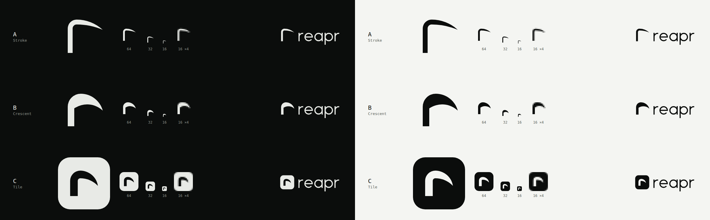

# Reapr brand

Reapr runs mutation testing on the lines a pull request changes. Tests kill mutants. The mutants that survive
show where the tests are weak. The identity is a technical reaper: one precise blade, bone on near-black,
no ornament.



## Mark

The mark is a lowercase `r` drawn as a scythe. The stem is the snath (the handle), and the arm is the blade.
Every curve is a circular arc, so the geometry is exact at any size. The mark is always one color.

Three variants are open for the owner to choose from. Once one is picked, it moves to `brand/mark.svg`
and the other two are deleted.

| Variant | File | Description |
| --- | --- | --- |
| A, Stroke | `variants/mark-a.svg` | A single light stroke: the stem turns a tight shoulder into a long, flat blade that tapers to a point. |
| B, Crescent | `variants/mark-b.svg` | A solid glyph: an upright stem flows into a heavy crescent blade with a needle tip. |
| C, Tile | `variants/mark-c.svg` | A monogram for app icons and avatars: a bold blade `r` cut out of a rounded square. The glyph also fits a circle. |

Each variant has a lockup (`variants/lockup-*.svg`) with the shared wordmark (`wordmark.svg`).

Construction notes:

- Canvas is a 32 × 32 viewBox. Marks A and B fill roughly x 6–27.5, y 6–26 (A rises to 5.5 for overshoot).
- The blade taper is two circles that meet at the tip. The inner circle is tangent to the shoulder, so the
  stroke thins with no kink.
- The A stem is 3 units wide (1.5 px at 16 px, slightly soft), and the B stem is 4 units (2 px, crisp).
  If A is chosen, use C or a 4-unit stem for favicons under 24 px.
- All files use `currentColor`, so they take the text color of the page. In an `` tag, `currentColor`
  renders black, so color the file or inline it.
- C is one compound path with `fill-rule="evenodd"`, not a mask, so it survives Figma, favicon generators
  and older renderers.

## Wordmark

`reapr`, always lowercase. It is a custom geometric monoline drawing (`wordmark.svg`), not a font, so it
renders the same everywhere. The stroke is 3.2 units on a 24-unit x-height. There is a single-story `a`, round
bowls and flat-cut terminals. In the lockups, the mark bottom sits on the baseline and its top reaches about
1.33 × the x-height.

When the name appears inside a sentence, set it as text: "Reapr" at the start of a sentence, `rpr` for the
CLI.

## Palette

The brand is monochrome: bone on near-black, and the inverse for light. The mark, the wordmark, buttons and
links are bone (on dark) or ink (on light), never green or amber.

Green and amber are status colors only. Green means killed, and amber means survived. They appear in product
output: verdicts, score deltas, a diff `+`, one dot in a table. They are never brand chrome, backgrounds,
buttons or the logo. As a rule of thumb, if a screen has more than a few words in either color, remove some.

### Dark (default)

| Token | Hex | Role | Contrast on bg `#0B0D0C` | On surface `#141715` |
| --- | --- | --- | --- | --- |
| `--bg` | `#0B0D0C` | Page background, near-black with a green cast | – | 1.08 |
| `--surface` | `#141715` | Raised panels, code blocks | 1.08 | – |
| `--border` | `#262B27` | Hairlines, dividers (decorative) | 1.35 | 1.25 |
| `--border-strong` | `#626962` | Input outlines, focus rings (non-text, 3:1) | 3.45 | 3.20 |
| `--muted` | `#8B918A` | Secondary text, captions | 6.05 (AA) | 5.60 (AA) |
| `--text` | `#E8EAE6` | Bone. Body text, the mark | 16.10 (AAA) | 14.91 (AAA) |
| `--killed` | `#B6F23A` | Status: killed mutants, success | 14.62 (AAA) | 13.54 (AAA) |
| `--survived` | `#F2A93A` | Status: surviving mutants, warning | 9.76 (AAA) | 9.04 (AAA) |

### Light

| Token | Hex | Role | Contrast on bg `#F4F5F2` | On surface `#FFFFFF` |
| --- | --- | --- | --- | --- |
| `--bg` | `#F4F5F2` | Page background, faint bone | – | 1.09 |
| `--surface` | `#FFFFFF` | Raised panels, code blocks | 1.09 | – |
| `--border` | `#D5D9D2` | Hairlines, dividers (decorative) | 1.31 | 1.43 |
| `--border-strong` | `#858B84` | Input outlines, focus rings (non-text, 3:1) | 3.19 | 3.49 |
| `--muted` | `#5B6159` | Secondary text, captions | 5.82 (AA) | 6.37 (AA) |
| `--text` | `#0B0D0C` | Ink. Body text, the mark | 17.82 (AAA) | 19.50 (AAA) |
| `--killed` | `#3D6B00` | Status: killed, darkened for AA on light | 5.81 (AA) | 6.36 (AA) |
| `--survived` | `#94560A` | Status: survived, darkened for AA on light | 5.34 (AA) | 5.84 (AA) |

The ratios are WCAG 2.x relative-luminance contrast, computed from the hex values above. `--border` is
decorative only: never use it alone to mark the edge of a control. If text sits on a status fill (rare, e.g. a
badge), use `--bg` on `#B6F23A` (14.62) or `--bg` on `#F2A93A` (9.76).

Pure `#E8EAE6` on `#F4F5F2` is 1.11: bone is for dark backgrounds only.

## Typography

| Role | Family | Weights | License | Fallback stack |
| --- | --- | --- | --- | --- |
| Text and headings | Instrument Sans (variable, `wght` 400–700, `wdth` 75–100) | 400 body, 500 UI, 600 headings | SIL Open Font License 1.1 | `"Instrument Sans", ui-sans-serif, system-ui, -apple-system, "Segoe UI", Roboto, sans-serif` |
| Code, CLI output, numbers in tables | JetBrains Mono | 400, 500 | SIL Open Font License 1.1 | `"JetBrains Mono", ui-monospace, SFMono-Regular, Menlo, Consolas, "Liberation Mono", monospace` |

- Self-host both families as WOFF2 (subset to Latin) from the upstream releases: Instrument Sans from
  `github.com/Instrument/instrument-sans`, and JetBrains Mono from `github.com/JetBrains/JetBrainsMono`. Do
  not load fonts from a CDN. Ship each `OFL.txt` next to the font files.
- Instrument Sans is a calm grotesque with a narrow width axis. Use `wdth` 100 for text. Narrower widths are
  only for dense tables.
- Headings are sentence case at weight 600 with letter-spacing `-0.01em`, never all caps. Body text is 16 px
  / 1.6, with lines kept under 72 characters.
- Mono is for things a user types or a machine prints: commands, paths, mutant diffs, scores. It is not for
  decorative labels.

## Voice

Short, technical, dry. State what the tool does and what the output means. No hype, no exclamation marks, no
"blazing", no "revolutionary".

- Tagline: **Kill the mutants your tests miss.**
- Secondary: **Mutation testing on every pull request.**
- Do: "3 mutants survived in `src/parse.rs`. A test passed when `>` became `>=`."
- Do: "Your tests passed. So did this bug."
- Do: "Scoped to the diff. Your config, your engine."
- Don't: "Supercharge your testing with AI-powered mutation magic!"
- Don't: reaper puns stacked in one sentence. One per page is plenty, and zero is fine.
- Errors say what happened and what to run next. They do not apologize.

## Usage rules

- **Clear space:** keep at least 25% of the mark height clear on all sides (8 units on the 32 grid). For a
  lockup, keep clear space equal to the wordmark's x-height.
- **Minimum size:** mark B and C: 16 px. Mark A: 20 px (24 px or more is preferred). Lockup: 80 px wide on
  screen, 20 mm in print.
- **Color:** one color only. Use bone `#E8EAE6` on dark and ink `#0B0D0C` on light. On photos, put the
  mark on a solid panel.
- **App icon / avatar:** use C. Bone tile on a dark surface, or ink tile on a light one. For a circular crop,
  keep the glyph and let the container be a circle.

Don't:

- Color the mark or wordmark green, amber, or with a gradient.
- Outline, shadow, glow, bevel, rotate, skew or animate the mark into a swing.
- Add skulls, hoods, drips or any other reaper decoration.
- Retype the wordmark in a font, change its case, or track it out.
- Rearrange the lockup (mark above the word, a different gap), or pair it with another logo inside the same
  clear space.
- Put the mark inside a container other than the C tile or a circle.

## Design tokens

```css
:root {
  /* dark is the default */
  --bg: #0B0D0C;
  --surface: #141715;
  --border: #262B27;
  --border-strong: #626962;
  --muted: #8B918A;
  --text: #E8EAE6;
  --killed: #B6F23A;   /* status only */
  --survived: #F2A93A; /* status only */

  --font-sans: "Instrument Sans", ui-sans-serif, system-ui, -apple-system, "Segoe UI", Roboto, sans-serif;
  --font-mono: "JetBrains Mono", ui-monospace, SFMono-Regular, Menlo, Consolas, "Liberation Mono", monospace;

  --radius-s: 4px;
  --radius-m: 8px;
  color-scheme: dark;
}

@media (prefers-color-scheme: light) {
  :root:not([data-theme="dark"]) {
    --bg: #F4F5F2;
    --surface: #FFFFFF;
    --border: #D5D9D2;
    --border-strong: #858B84;
    --muted: #5B6159;
    --text: #0B0D0C;
    --killed: #3D6B00;
    --survived: #94560A;
    color-scheme: light;
  }
}

:root[data-theme="light"] {
  --bg: #F4F5F2;
  --surface: #FFFFFF;
  --border: #D5D9D2;
  --border-strong: #858B84;
  --muted: #5B6159;
  --text: #0B0D0C;
  --killed: #3D6B00;
  --survived: #94560A;
  color-scheme: light;
}
```
