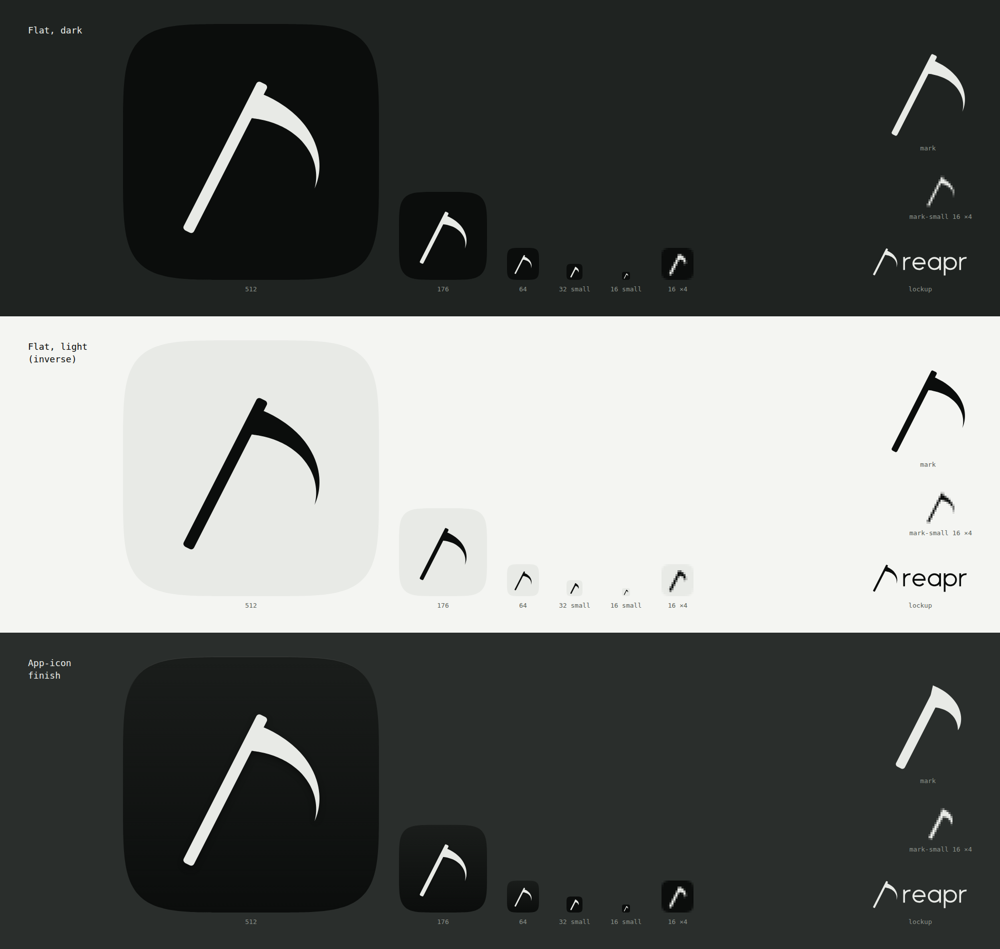

# Reapr brand

Reapr runs mutation testing on the lines a pull request changes. Tests kill mutants. The mutants that survive
show where the tests are weak. The identity is a technical reaper: one scythe, bone on near-black, no
ornament.



## Mark

The mark is a scythe, the old public-domain reaper's tool. A straight snath (handle) leans 27° from vertical,
and a crescent blade, fixed near the top, sweeps right and down to a fine point. The mark is always one color.

| File | Use |
| --- | --- |
| `mark.svg` | Standalone scythe, `currentColor`. Use it next to the wordmark and anywhere above 32 px. |
| `mark-small.svg` | 32 px and below: a heavier snath and a shorter, wider blade. |
| `icon.svg` | Flat tile: bone scythe on a near-black squircle. The default icon everywhere. |
| `icon-small.svg` | Flat tile with `mark-small` inside, for favicons at 16 and 32 px. |
| `icon-app.svg` | App-icon finish, for app stores, docks and launch screens (see Finishes). |
| `lockup.svg` | Mark plus wordmark, `currentColor`: bone on dark, ink on light. |
| `wordmark.svg` | The wordmark on its own. |
| `export/` | `favicon.ico` (16, 32, 48), `icon-512.png` and `icon-1024.png` (app-icon finish), `github-avatar-500.png` (flat, full bleed, because GitHub rounds avatars itself), `og-image-1200x630.png`. |

`archive/` keeps the explored variants A–F and their sheets (`sheet.png`, `sheet-2.png`) for reference. Do
not use them.

### Construction

The SVGs are generated by `tools/gen-mark.py` (Python standard library only). Run
`python3 brand/tools/gen-mark.py brand` to rebuild them. Design space is about 100 units; the snath is 92 long.

- **Snath:** a straight bar 6.4 wide (11 in `mark-small`), with corners rounded at 28% of its width. Its top
  end stands just above the blade, like the end of a real snath. In `mark-small`, the blade covers it.
- **Blade spine:** an Euler spiral, so curvature grows linearly with arc length, from 1/80 at the heel to 1/26
  at the tip (66 units long). The spine starts perpendicular to the snath, lifted 12°, and turns about 90°
  so the point hangs down. The spine has no kinks because curvature never jumps.
- **Blade outline:** the back and the cutting edge are offsets of the spine by a width
  `w(u) = 15 · (1 − u)^1.1`, split 42% to the back and 58% to the edge. Both edges are smooth and meet only at
  the tip, a fine needle point. The outline is sampled more densely toward the tip and fitted with
  Catmull-Rom cubic Béziers.
- **Stroke logic:** the blade heel is 15, about 2.3 × the snath. The blade tapers, and the snath stays
  constant.
- **Tile:** a superellipse `|x|^5 + |y|^5 = 1`, the continuous-curvature corner Apple's icons use, not a
  rounded rectangle. It is sampled at 128 points and fitted with closed Catmull-Rom Béziers on a 1024 grid.
- **Placement:** in the tile, the scythe is scaled to 60% of the tile (20% padding on the long axis). It is
  centered at a 60/40 blend of the bounding-box center and the area centroid, so the heavy blade does not
  pull the mark off balance. The resulting padding is 23% left, 22% top, 23% right and 18% bottom.

### Finishes

- **Flat (default, everywhere):** bone `#E8EAE6` on near-black `#0B0D0C`, or the inverse, ink on bone. One
  color per surface, no effects. Use this on the website, in docs, in the README, in the CLI and in social
  avatars.
- **App icon (`icon-app.svg`, `icon-512.png`, `icon-1024.png`):** a near-black tile with a tonal gradient
  (`#1A1D1B` at the top to `#0B0D0C` at the bottom), a 2-unit inner highlight on the top edge (white, 14% →
  0% over the top 16%), a bone scythe, and a very soft shadow under it (black, 35%, blur 14, offset 12 on the
  1024 grid). It stays monochrome, with no color and no glow. Use it only where platforms expect an app icon.

## Wordmark

`reapr`, always lowercase. It is a custom geometric monoline drawing (`wordmark.svg`), not a font, so it
renders the same everywhere. The stroke is 3.2 units on a 24-unit x-height. There is a single-story `a`, round
bowls and flat-cut terminals. In the lockup, the scythe runs from above the x-height down to the descender of
the `p`, with a gap of 11 units before the word.

When the name appears inside a sentence, set it as text: "Reapr" at the start of a sentence, `rpr` for the
CLI.

## Palette

The brand is monochrome: bone on near-black, and the inverse for light. The mark, the wordmark, buttons and
links are bone (on dark) or ink (on light), never green or amber.

Green and amber are status colors only. Green means killed, and amber means survived. They appear in product
output: verdicts, score deltas, a diff `+`, one dot in a table. They are never brand chrome, backgrounds,
buttons or the logo. As a rule of thumb, if a screen has more than a few words in either color, remove some.

### Dark (default)

| Token | Hex | Role | Contrast on bg `#0B0D0C` | On surface `#141715` |
| --- | --- | --- | --- | --- |
| `--bg` | `#0B0D0C` | Page background, near-black with a green cast | – | 1.08 |
| `--surface` | `#141715` | Raised panels, code blocks | 1.08 | – |
| `--border` | `#262B27` | Hairlines, dividers (decorative) | 1.35 | 1.25 |
| `--border-strong` | `#626962` | Input outlines, focus rings (non-text, 3:1) | 3.45 | 3.20 |
| `--muted` | `#8B918A` | Secondary text, captions | 6.05 (AA) | 5.60 (AA) |
| `--text` | `#E8EAE6` | Bone. Body text, the mark | 16.10 (AAA) | 14.91 (AAA) |
| `--killed` | `#B6F23A` | Status: killed mutants, success | 14.62 (AAA) | 13.54 (AAA) |
| `--survived` | `#F2A93A` | Status: surviving mutants, warning | 9.76 (AAA) | 9.04 (AAA) |

### Light

| Token | Hex | Role | Contrast on bg `#F4F5F2` | On surface `#FFFFFF` |
| --- | --- | --- | --- | --- |
| `--bg` | `#F4F5F2` | Page background, faint bone | – | 1.09 |
| `--surface` | `#FFFFFF` | Raised panels, code blocks | 1.09 | – |
| `--border` | `#D5D9D2` | Hairlines, dividers (decorative) | 1.31 | 1.43 |
| `--border-strong` | `#858B84` | Input outlines, focus rings (non-text, 3:1) | 3.19 | 3.49 |
| `--muted` | `#5B6159` | Secondary text, captions | 5.82 (AA) | 6.37 (AA) |
| `--text` | `#0B0D0C` | Ink. Body text, the mark | 17.82 (AAA) | 19.50 (AAA) |
| `--killed` | `#3D6B00` | Status: killed, darkened for AA on light | 5.81 (AA) | 6.36 (AA) |
| `--survived` | `#94560A` | Status: survived, darkened for AA on light | 5.34 (AA) | 5.84 (AA) |

The ratios are WCAG 2.x relative-luminance contrast, computed from the hex values above. `--border` is
decorative only: never use it alone to mark the edge of a control. If text sits on a status fill (rare, e.g. a
badge), use `--bg` on `#B6F23A` (14.62) or `--bg` on `#F2A93A` (9.76).

Pure `#E8EAE6` on `#F4F5F2` is 1.11: bone is for dark backgrounds only.

## Typography

| Role | Family | Weights | License | Fallback stack |
| --- | --- | --- | --- | --- |
| Text and headings | Instrument Sans (variable, `wght` 400–700, `wdth` 75–100) | 400 body, 500 UI, 600 headings | SIL Open Font License 1.1 | `"Instrument Sans", ui-sans-serif, system-ui, -apple-system, "Segoe UI", Roboto, sans-serif` |
| Code, CLI output, numbers in tables | JetBrains Mono | 400, 500 | SIL Open Font License 1.1 | `"JetBrains Mono", ui-monospace, SFMono-Regular, Menlo, Consolas, "Liberation Mono", monospace` |

- Self-host both families as WOFF2 (subset to Latin) from the upstream releases: Instrument Sans from
  `github.com/Instrument/instrument-sans`, and JetBrains Mono from `github.com/JetBrains/JetBrainsMono`. Do
  not load fonts from a CDN. Ship each `OFL.txt` next to the font files.
- Instrument Sans is a calm grotesque with a narrow width axis. Use `wdth` 100 for text. Narrower widths are
  only for dense tables.
- Headings are sentence case at weight 600 with letter-spacing `-0.01em`, never all caps. Body text is 16 px
  / 1.6, with lines kept under 72 characters.
- Mono is for things a user types or a machine prints: commands, paths, mutant diffs, scores. It is not for
  decorative labels.

## Voice

Short, technical, dry. State what the tool does and what the output means. No hype, no exclamation marks, no
"blazing", no "revolutionary".

- Primary line: **Reapr — Mutation testing for your AI agents.**
- Supporting line: **Kill the mutants your tests miss.**
- Keep it honest: Reapr works the same on pull requests written by people. Lead with agents, never claim it
  is only for them.
- Do: "3 mutants survived in `src/parse.rs`. A test passed when `>` became `>=`."
- Do: "Your tests passed. So did this bug."
- Do: "Scoped to the diff. Your config, your engine."
- Don't: "Supercharge your testing with AI-powered mutation magic!"
- Don't: reaper puns stacked in one sentence. One per page is plenty, and zero is fine.
- Errors say what happened and what to run next. They do not apologize.

## Usage rules

- **Clear space:** keep at least 25% of the mark height clear on all sides (8 units on the 32 grid). For a
  lockup, keep clear space equal to the wordmark's x-height.
- **Minimum size:** mark and icon: 16 px, using `mark-small.svg` / `icon-small.svg` at 32 px and below.
  Use `mark.svg` / `icon.svg` from 33 px up. Lockup: 96 px wide on screen, 20 mm in print.
- **Color:** one color only. Use bone `#E8EAE6` on dark and ink `#0B0D0C` on light. On photos, put the
  mark on a solid panel.
- **App icon / avatar:** use `icon.svg` (flat) or `icon-app.svg` (app stores). For a circular crop, keep the
  scythe and its placement, and let the container be a circle.

Don't:

- Color the mark or wordmark green, amber, or with a gradient.
- Outline, glow, bevel, rotate, skew or animate the mark into a swing. The only shadow is the one built into
  `icon-app.svg`.
- Add skulls, hoods, figures, drips or any other reaper decoration. The scythe is enough.
- Trace a specific scythe from a film, game or book. The archetype is public domain; someone's prop is not.
- Mirror the scythe. The blade points right, toward the reading direction.
- Retype the wordmark in a font, change its case, or track it out.
- Rearrange the lockup (mark above the word, a different gap), or pair it with another logo inside the same
  clear space.
- Put the mark inside a container other than the squircle tile or a circle. Never use a plain rounded
  rectangle.
- Add the nib (grip) back, or use the archived variants.

## Design tokens

```css
:root {
  /* dark is the default */
  --bg: #0B0D0C;
  --surface: #141715;
  --border: #262B27;
  --border-strong: #626962;
  --muted: #8B918A;
  --text: #E8EAE6;
  --killed: #B6F23A;   /* status only */
  --survived: #F2A93A; /* status only */

  --font-sans: "Instrument Sans", ui-sans-serif, system-ui, -apple-system, "Segoe UI", Roboto, sans-serif;
  --font-mono: "JetBrains Mono", ui-monospace, SFMono-Regular, Menlo, Consolas, "Liberation Mono", monospace;

  --radius-s: 4px;
  --radius-m: 8px;
  color-scheme: dark;
}

@media (prefers-color-scheme: light) {
  :root:not([data-theme="dark"]) {
    --bg: #F4F5F2;
    --surface: #FFFFFF;
    --border: #D5D9D2;
    --border-strong: #858B84;
    --muted: #5B6159;
    --text: #0B0D0C;
    --killed: #3D6B00;
    --survived: #94560A;
    color-scheme: light;
  }
}

:root[data-theme="light"] {
  --bg: #F4F5F2;
  --surface: #FFFFFF;
  --border: #D5D9D2;
  --border-strong: #858B84;
  --muted: #5B6159;
  --text: #0B0D0C;
  --killed: #3D6B00;
  --survived: #94560A;
  color-scheme: light;
}
```
